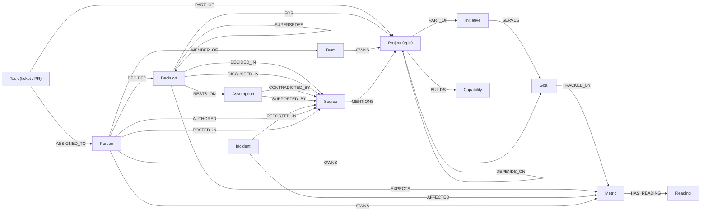

# Splat

**A company brain that checks whether decisions worked, whether the reasons behind them still hold, and why any piece of work exists.**

Companies remember *what* they decided. They rarely check *whether it worked*, and they almost never notice when the reason a decision was made stops being true. Splat connects decisions, the assumptions they rest on, the results they promised, the evidence for and against them, and the goals and work they created into one knowledge graph in [FalkorDB](https://www.falkordb.com/). Every answer is computed from that graph, cites the files it came from, and shows the queries that produced it.

**Live demo: https://splat-i2jd.onrender.com** (no sign-up, no key; the app itself is at [/app](https://splat-i2jd.onrender.com/app)). It runs on a free plan, so if it has been idle the first load can take up to a minute; everything after that is quick. To run it on your own machine instead, see [Run it locally](#run-it-locally).

Ask it, for example:

| Question | What comes back |
|---|---|
| *Did the guided onboarding checklist work?* | **Ambiguous.** Churn fell 19.2% against a promised 10%, but a second decision (an annual discount) hit the same metric in the same weeks, so neither can take the credit. |
| *What breaks if A-1 is wrong?* | Everything resting on the assumption "invoice traffic is read-heavy": 3 decisions, 4 epics and 5 open tickets, up to 4 steps away, plus the goal at risk and the people to tell. |
| *Which assumptions should we verify first?* | Untested beliefs ranked by PageRank over everything that relies on them. |
| *Are we wasting effort anywhere?* | 4 epics and 4 tickets with no path to a live goal, including EU work that continued for months after the EU launch was cancelled. |
| *Are two teams building the same thing?* | Payments and Platform are both building retry tooling, and they sit in separate conversation islands: no chain of people who have talked connects them. |
| *Who knows the most about webhook retries?* | People ranked by evidence: Neha Moreau decided D-112, wrote its record, worked ticket KES-148 and led the epic; every item is cited. |
| *Who owns EP-13?* | The Payments team, through decision D-112 by Neha Moreau, toward goal G-5. |
| *What changed in the last 30 days?* | A decision replaced, an assumption disproved by an exit survey, new decisions, each with its source. |
| *Did the blockchain rewrite work?* | **Not in the graph.** Nothing is guessed. |

---

## Contents

- [What it does](#what-it-does)
- [Why it needs a graph](#why-it-needs-a-graph)
- [Run it locally](#run-it-locally)
- [How it works](#how-it-works)
- [The graph data model](#the-graph-data-model)
- [The Cypher and graph algorithms it depends on](#the-cypher-and-graph-algorithms-it-depends-on)
- [How a decision is judged](#how-a-decision-is-judged)
- [Safety](#safety)
- [The data](#the-data)
- [Limitations](#limitations)
- [Project layout](#project-layout)
- [AI assistance](#ai-assistance)

---

## What it does

The web app has six views, switched from a dock at the bottom of the page.

| View | Purpose |
|---|---|
| **Ask** | Ask anything in plain language. Answers show a verdict, the promised and measured result, the explanation, clickable sources that open the real Slack thread or document, the graph behind the answer, and every query that ran with its timing. |
| **Outcomes** | Every decision judged against the result it promised: worked, partly worked, missed, ambiguous, too early, not shipped, or never defined success. |
| **Assumptions** | Assumptions that turned out false and every decision resting on them, flagging decisions made *after* the evidence appeared and decisions that are still live. Untested assumptions are ranked by how much rests on them, and any of them can be traced as a blast-radius tree. |
| **Graph** | The company map: goals, initiatives, epics, decisions, assumptions, metrics and capabilities, coloured by verdict and status. Click a node to highlight its neighbours and ask about it. |
| **Act** | **Tell Splat something new:** paste a new Slack message or note; Splat finds the epics it mentions and the assumptions it contradicts or supports, quoting the words that show it, tries the update on a throwaway copy of the graph, and adds it only after a person approves. Below that, one proposed fix per problem found, tried on a copy first and verified after approval. |
| **Alignment** | Work that serves no live goal, goals nobody is working on, work continuing under cancelled goals, metrics nobody owns, and teams duplicating each other's work. |

### How it covers what a company brain needs

| Need | How Splat does it |
|---|---|
| **Knowledge from docs, tickets and chats in one graph** | Slack threads, decision records, research notes, incident reports, Jira tickets, pull requests, metrics and the org chart are imported into one FalkorDB graph and linked to the people, teams, epics and decisions they concern. New messages are read into the graph from the Act view. |
| **Who owns what, and who knows what** | Ownership of every epic, metric, goal and decision through teams, deciders and goal owners, with membership tracked over time. Expertise ranked by evidence of real work (decisions made, tickets worked, threads and documents written), with people who have left listed separately. |
| **Tracing decisions back to their source** | Every decision links to its decision record, the thread where it was discussed, the assumptions it rested on and the evidence that later disproved or supported them. |
| **Keeping knowledge current as things change** | Assumptions are disproved or supported as evidence arrives, decisions are superseded, goals cancelled, people leave or move teams; "what changed?" lists it all. A new message updates the graph after approval, and every decision resting on a newly disproved assumption is flagged at once. |
| **Answers with clear sources** | Every answer cites the files it came from, down to the export row (for example `planning/epics.csv#EP-11`), shows the graph path and every query that ran, and says "not in the graph" instead of guessing. |

## Why it needs a graph

Every answer above is a chain of connections, not a passage of text.

| Question | What it takes | Graph | Text or vector search |
|---|---|---|---|
| Did a decision work? | decision → promised metric → readings before and after, **plus** every other decision or incident on the same metric in the same window | a few hops and a time filter | finds documents that sound related; cannot tell that two changes overlapped |
| What breaks if an assumption is wrong? | everything that relies on it, **at any depth** | one variable-length pattern, `-[:RELIES_ON*1..]->` | cannot follow dependencies |
| Which assumptions carry the most weight? | importance across the whole dependency network | PageRank | no notion of structure |
| Are these two teams connected at all? | proof that **no** chain of conversation links them | connected components | cannot prove absence |
| Which work serves no goal? | proof that **no** path exists from the work to a live goal | path existence | cannot prove absence |
| Does every fact have a source? | a rule nobody can bypass | enforced by the database (`MANDATORY` constraint) | — |

Remove FalkorDB and none of these answers can be produced.

## Run it locally

You need [Docker](https://docs.docker.com/get-docker/), Python 3.11 or newer, and [uv](https://docs.astral.sh/uv/getting-started/installation/).

```bash
git clone https://github.com/maneesh-30/splat.git
cd splat
docker compose up -d          # FalkorDB on :6379, FalkorDB Browser on :3000
cp .env.example .env          # on Windows PowerShell: Copy-Item .env.example .env
uv sync
uv run splat load             # import the company data into FalkorDB
uv run splat serve            # open http://localhost:8000
```

`uv run splat` on its own checks the database connection. If FalkorDB is not running, the app and the CLI say so plainly instead of returning empty answers.

**Optional language model.** Add a free [Groq](https://console.groq.com/) key to `.env` as `GROQ_API_KEY=...` to let a model understand questions in any wording and add a short summary to each answer. Without a key, everything still works: questions are routed by keyword rules and answers are shown without the summary.

### From the command line

```bash
uv run splat ask "Did the guided onboarding checklist work?"
uv run splat ask "What breaks if A-1 is wrong?" --trace     # also print every query that ran
uv run splat generate                                        # rebuild the synthetic company files
uv run splat load                                            # re-import (also resets any applied actions)
```

### Explore the raw graph

Open the FalkorDB Browser at http://localhost:3000, connect to `localhost:6379` with no password, choose the graph `kestrel`, and run for example:

```cypher
MATCH p = (d:Decision)-[:RESTS_ON]->(a:Assumption)-[:CONTRADICTED_BY]->(s:Source)
RETURN p
```

### Run it as one container

The `Dockerfile` packages FalkorDB and the app into a single image (built from the same pinned FalkorDB image). On start it launches FalkorDB inside the container, loads the company data and serves the app on `$PORT`. It uses about 85 MB of memory.

```bash
docker build -t splat .
docker run -p 8000:8000 -e GROQ_API_KEY=... splat     # the key is optional
```

The live demo is this image on Render, described by [`render.yaml`](render.yaml). Every start reloads the data, so actions applied on the live demo reset with each deploy.

## How it works

```
 tool exports (Slack, Jira, GitHub, docs, metrics, org chart)
        │  importer: batched, idempotent UNWIND … MERGE
        ▼
 staging graph ──GRAPH.COPY──▶ live graph "kestrel"     constraints enforced by FalkorDB
        │                                                (unique ids, every fact has a source)
        ▼
 graph tools: fixed, parameterised, read-only Cypher with a 3 s timeout
        │
        ▼
 agent: chooses one tool per question (keyword rules, or a language model choosing from the fixed list)
        │
        ▼
 answer: verdict, numbers, path, sources and query trace, composed only from the rows returned
        │   optional model summary, checked against those rows
        ▼
 web app / CLI                      actions: proposed → tried on a GRAPH.COPY sandbox → approved → applied → verified
```

- **Import.** `src/splat/exports.py` reads the exports, and `src/splat/ingest.py` writes them with batched `UNWIND $rows AS row MERGE …`, so re-running the import changes nothing. Data is loaded into a staging graph and copied over the live graph only when complete, so the app never reads a half-imported graph; the graph is then saved to disk immediately.
- **Tools.** `src/splat/tools.py` runs the queries in `src/splat/queries.py` with `GRAPH.RO_QUERY` and a timeout, and records each query, its parameters, row count and time for the answer's trace.
- **Agent.** `src/splat/agent.py` maps a question to one tool. Names are resolved against the graph with full-text search, and a match must cover most of the question's specific words, so an unknown name gets "not in the graph" rather than the closest-sounding item.
- **Language model (optional).** `src/splat/llm.py` lets a Groq-hosted model choose the tool and name its subject from a catalogue of ids, and rewrite a finished answer in two to four sentences. It never writes a query or touches data.
- **Actions.** `src/splat/actions.py` holds one fixed, reviewed write per kind of fix.

## The graph data model



### Nodes

| Label | What it is | Key properties | Count |
|---|---|---|---|
| `Goal` | what the company wants to achieve | `title`, `status` (active / cancelled), `cancelled_at` | 7 |
| `Initiative` | a programme of work serving a goal | `title`, `status` | 8 |
| `Project` | an epic: one concrete piece of work | `title`, `status` | 29 |
| `Task` | a Jira ticket or GitHub pull request | `kind`, `title`, `created_at`, `closed_at` | 136 |
| `Decision` | a choice the company made | `title`, `decided_at`, `shipped_at`, `status` | 30 |
| `Assumption` | a belief a decision rests on | `statement` | 17 |
| `Metric` | a number tracked weekly | `name`, `unit`, `better` (higher / lower) | 11 |
| `Reading` | one weekly value of a metric | `at`, `value` | 583 |
| `Incident` | something that disturbed a metric | `title`, `at`, `until` | 1 |
| `Capability` | a reusable thing several epics might build | `name` | 4 |
| `Source` | a Slack thread or document; its id is the file it lives in | `kind`, `title`, `at`, `text` | 438 |
| `Person`, `Team` | people and teams | `name`, `email` | 40, 5 |
| `Company` | the dataset itself | `as_of` (the date "today" is judged from) | 1 |

### Relationships carrying facts

| Relationship | Meaning | Properties |
|---|---|---|
| `(Decision)-[:EXPECTS]->(Metric)` | the result a decision promised | `change` (relative), `judge_by`, `source_id` |
| `(Decision)-[:RESTS_ON]->(Assumption)` | why it was decided | `source_id` |
| `(Assumption)-[:CONTRADICTED_BY]->(Source)` | the evidence that disproved it | `at` |
| `(Incident)-[:AFFECTED]->(Metric)` | an outside event on a metric | `source_id` |
| `(Person)-[:MEMBER_OF]->(Team)` | team membership over time | `since`, `until` |

The fact-carrying relationships have `MANDATORY` constraints on their properties, so FalkorDB itself rejects a fact written without its source. Every node label has a `UNIQUE` constraint on `id`.

### Derived relationships

Two relationship types are derived at import time so graph algorithms can run on a single type:

- **`RELIES_ON`** points from anything to what it cannot stand without: decision → assumption, decision → the decision it builds on, epic → the decision that created it, epic → the epic it depends on, open ticket → its epic. Blast radius and PageRank run on it.
- **`TALKS_WITH`** links people who posted in the same Slack thread. Connected components run on it to find conversation islands.

## The Cypher and graph algorithms it depends on

Every query the product runs is a named constant in [`src/splat/queries.py`](src/splat/queries.py); the language model can only choose among tools built on them. The central ones:

**Blast radius: everything that relies on an assumption, at any depth**
```cypher
MATCH p = (n)-[:RELIES_ON*1..]->(:Assumption {id: $id})
WITH n, min(length(p)) AS hops
RETURN labels(n)[0], n.id, coalesce(n.title, n.id), n.status, hops
ORDER BY hops, n.id
```

**Load-bearing assumptions: PageRank over `RELIES_ON`**
```cypher
CALL algo.pageRank(NULL, 'RELIES_ON') YIELD node, score
WITH node, score WHERE node:Assumption
OPTIONAL MATCH (node)-[c:CONTRADICTED_BY]->()
OPTIONAL MATCH (node)-[s:SUPPORTED_BY]->()
OPTIONAL MATCH (x)-[:RELIES_ON*1..]->(node)
RETURN node.id, node.statement, score, count(DISTINCT c) > 0, count(DISTINCT s) > 0, count(DISTINCT x)
ORDER BY score DESC
```

**Conversation islands: weakly connected components over `TALKS_WITH`**
```cypher
CALL algo.WCC({nodeLabels: ['Person'], relationshipTypes: ['TALKS_WITH']}) YIELD node, componentId
OPTIONAL MATCH (node)-[m:MEMBER_OF]->(t:Team) WHERE m.until IS NULL
RETURN node.id, node.name, componentId, t.id
```

**Overlap check: other changes on the same metric inside a decision's judging window**
```cypher
MATCH (d:Decision {id: $id})-[:EXPECTS]->(m:Metric)<-[:EXPECTS]-(other:Decision)
WHERE other <> d AND other.shipped_at IS NOT NULL
  AND other.shipped_at > $from AND other.shipped_at <= $to
RETURN other.id, other.title, other.shipped_at
```

**Disproved assumptions and every decision resting on them**
```cypher
MATCH (a:Assumption)-[c:CONTRADICTED_BY]->(s:Source)
WHERE $id IS NULL OR a.id = $id
MATCH (d:Decision)-[:RESTS_ON]->(a)
OPTIONAL MATCH (author:Person)-[:AUTHORED]->(s)
OPTIONAL MATCH (owner:Person)-[:DECIDED]->(d)
RETURN a.id, a.statement, c.at, s.id, s.title, author.name,
       d.id, d.title, d.status, d.decided_at, d.shipped_at, owner.name
ORDER BY a.id, d.decided_at
```

**Work with no path to a live goal**
```cypher
MATCH (p:Project) WHERE p.status = 'active'
OPTIONAL MATCH (team:Team)-[:OWNS]->(p)
OPTIONAL MATCH (p)-[:PART_OF]->(:Initiative)-[:SERVES]->(g:Goal)
WITH p, team, collect(g) AS goals
WHERE size([g IN goals WHERE g.status = 'active']) = 0
RETURN p.id, p.title, team.name, [g IN goals | g.id + ' (' + g.status + ')'] AS reached
```

**Also used:** full-text indexes (`db.idx.fulltext.queryNodes`) to resolve names in questions and to find similar past decisions; `GRAPH.CONSTRAINT` for uniqueness and mandatory provenance; and `GRAPH.COPY` both to swap a finished import into place and to create the throwaway sandbox each proposed action is tried on.

## How a decision is judged

A decision is judged against its own promise, recorded as `(Decision)-[:EXPECTS {change, judge_by}]->(Metric)`.

1. **Baseline:** the mean of the metric's weekly readings in the 4 weeks before the decision shipped.
2. **Outcome:** the mean of the readings in the 4 weeks up to its judge-by date.
3. **Overlaps:** any other decision that promised to move the same metric and shipped inside that window, or any incident on that metric overlapping it, makes the result **ambiguous**: the change cannot be credited to one decision.
4. Otherwise it **worked** if it reached at least 80% of the promised change, **partly worked** at 30–80%, and **missed** below that.
5. A decision is **too early** if its judge-by date is after the data's as-of date, **not shipped** if it never shipped, and **never defined success** if it promised no measurable result.

## Safety

- **No model-written queries.** Every query is fixed, parameterised and reviewed. A language model can only choose a tool and name a subject from a catalogue of ids.
- **Read-only answers.** Answers run through `GRAPH.RO_QUERY` with a 3-second timeout.
- **Checked summaries.** A model-written summary keeps a sentence only if every id and number in it appears in the rows the graph returned; the rest is dropped, and the answer says how many sentences were removed.
- **No guessing.** Unknown names return "not in the graph".
- **Writes only on approval.** The only writes outside the import are the fixed writes in the Act view: adding a new message and applying a proposed fix. When a model reads a new message, every id it names must exist in the graph and every quote must appear in the message, or that finding is dropped. Each is first applied to a throwaway `GRAPH.COPY` of the graph and compared; the real graph changes only after a person approves, the action is recorded as an `Action` node, and the original check is re-run to verify the result.
- **Provenance enforced by the database.** `MANDATORY` constraints mean a fact without a source cannot be stored.
- **Safe imports.** Batched, idempotent `MERGE`; staging graph swapped in only when complete; saved to disk right after loading; graph copies retried if the server is busy saving.
- **Honest failures.** If FalkorDB is unreachable, the app shows a banner and the API returns a 503 rather than empty answers. If the language model is unavailable or rate-limited, the keyword router takes over.
- **Pinned database.** `docker-compose.yml` pins the FalkorDB image by digest.

## The data

The data describes **Kestrel**, a fictional 40-person invoicing company over one year. It is **synthetic**: generated by [`src/splat/generate.py`](src/splat/generate.py) with a fixed seed, so `uv run splat generate` reproduces it exactly. No real company, person or customer data is used.

It is written as the files real tools export, in [`data/kestrel/`](data/kestrel):

| Folder | Format |
|---|---|
| `slack/` | Slack export format: `users.json`, `channels.json`, one JSON file per channel per day, with threads and replies |
| `docs/decisions/` | one Markdown decision record per decision, with front matter (assumptions, promised result, judge-by date, thread it was discussed in) |
| `docs/notes/`, `incidents/` | research notes and an incident report |
| `jira/issues.csv`, `github/pull_requests.csv` | tickets and pull requests |
| `metrics/` | metric definitions and a year of weekly readings |
| `org/`, `planning/`, `assumptions/` | org chart and team history; goals, initiatives and epics; the assumption register |

The importer reads only these files, so a real company could point it at its own exports in the same shapes.

The company contains planted stories (decisions that worked, missed and overlapped; an incident that confounds a result; assumptions disproved before and after decisions relied on them; work that outlived its goal; a metric whose owner left; two teams duplicating work) among about 180 everyday messages (standups, bug reports, questions, chatter) that relate to none of them. The true effect of each decision is used only to synthesise metric readings and is never exported, so outcomes have to be recovered from the readings.

## Limitations

- **Synthetic data.** The stories are designed, so the data shows what the mechanism finds rather than proving it on a real company.
- **Recorded facts only.** A decision's reasons and promised result must be written down. Assumptions are disproved by evidence in the assumption register or by a new message a person approves; messages are read one at a time from the Act view, not streamed in automatically from Slack.
- **Correlation, not causation.** A verdict compares a metric before and after a decision and flags overlapping changes it knows about; changes that are not recorded in the graph cannot be accounted for.
- **Summaries are checked for ids and numbers, not meaning.** A summary sentence can still phrase a fact loosely; the lines below it, which come straight from the graph, are authoritative.
- **Fixed question types.** It answers the questions its tools cover, not arbitrary ones.

## Project layout

```
src/splat/
  generate.py   synthetic company and its tool exports
  exports.py    reading and writing the export formats
  schema.py     indexes and constraints
  ingest.py     batched, staged import
  queries.py    every Cypher query the product runs
  tools.py      graph tools with verdicts and a query trace
  agent.py      question routing and answers
  llm.py        optional model routing and checked summaries
  actions.py    proposed fixes, sandbox dry runs and approved writes
  learn.py      reading new messages into the graph, with a sandbox check and approval
  web.py        HTTP API
  static/       the web app (HTML, CSS, JavaScript, Cytoscape.js)
data/kestrel/   the company as tool exports
docker-compose.yml   FalkorDB, pinned by digest
Dockerfile           FalkorDB and the app in one image, for deployment
render.yaml          the live demo's deployment on Render
```

## AI assistance

This project was built with AI assistance, disclosed here in full:

- **Claude (Anthropic)** was used as a coding assistant: drafting and reviewing code, Cypher, the synthetic data generator and this README, and checking results against the raw files.
- **A Groq-hosted language model** runs inside the app, only when a key is configured, to choose a tool for a question and to write the optional summary described above.

The problem choice, product design, data model, the planted data stories, and the verification of every result against the raw export files were done by the author, who reviewed and understands all the code.
